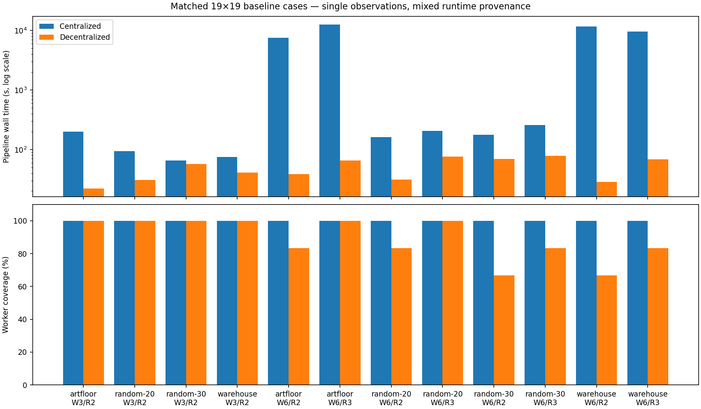
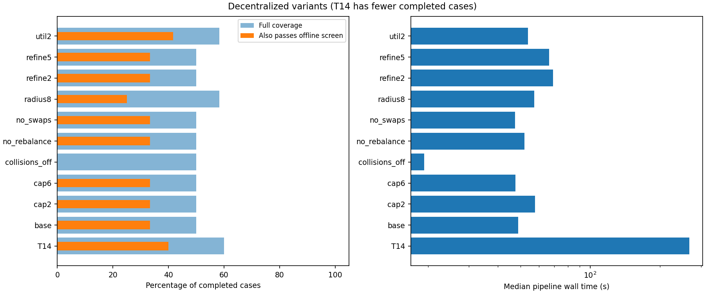

# Completed-run comparative study

## Scope and data audit

This study uses **194 completed jobs only**, from `mrp_backup/study-20261114-180038`. Interrupted jobs with no completed result are excluded, without rerunning them. There are 150 decentralized and 44 centralized observations. Grids: {'19x19': 186, '25x25': 8}. All runs use seed 0, so these are single observations per configuration, not repeated statistical trials.

The centralized comparator is this project's Python/Z3 port (`centralized.py` calling `twoshot.solve_isolated`), not a fresh execution of the paper repository's original C++ binary. Collision checks are enabled in the main comparison and disabled in a separate ablation; Phase 2 cost optimization is optional and off for the main comparison. Results therefore compare the two implementations/configurations in this project, rather than directly reproduce the paper's published timings or full optimization configuration. The two-shot method is not a globally optimal joint scheduler, so a decentralized candidate can have higher measured efficiency without contradicting global optimality theory.

The completed CSV and canonical per-job JSON files contain the same job IDs. Numeric CSV/JSON discrepancies: 0. `test_job.result.json` duplicates job 1 and is excluded; the numbered `0001.result.json` is retained. Old study folders and stale CSVs are excluded. Completed 25×25 and T14 results are included in their own sections and in the audited output. No inference is made about unfinished jobs.

Summed recorded pipeline time: **23.79 compute hours**. This sum is not calendar duration because notebooks ran concurrently. Hardware, notebook concurrency, dependency versions and CPU allocation are not recorded per job; absolute timings and speed ratios are descriptive, not hardware-controlled estimates.

## Definitions and acceptance screen

- Coverage is the percentage of all requested workers included in successful local plans. A partial solution is a coverage result; it cannot be credited with full-system efficiency.
- Hard and soft efficiencies are the implementation's paper-style worker waiting-time metrics. Higher is better. The decentralized metric aggregates live groups using worker-horizon weights; unequal group periods mean it is not a measured globally synchronized execution rate. Efficiencies are left blank for partial coverage.
- Primitive cost is summed recharger primitive cost over the saved cycle plans. Different cycle lengths can change this total; a lower raw cycle cost alone does not establish a lower long-run cost rate.
- A decentralized **offline screen pass** requires 100% coverage, zero reported conflicts, no fallback groups and deployment `READY`. This is stricter than the stored `SAT` or `candidate_valid` fields. It remains a modeled offline check, not a physical execution guarantee.
- Centralized screening checks full coverage and zero conflicts; deployment is absent from that baseline and therefore cannot be compared as equivalent setup functionality.
- `SAT` in decentralized benchmark output means full coverage only: `benchmark.py:95` derives it from coverage, independently of fallback, collisions and deployment readiness.

## Centralized versus decentralized baseline: original 19×19 maps

There are 12 matched baseline pairs. Centralized coverage is 100% in all 12; decentralized full coverage is achieved in 6/12. Mean decentralized coverage is 88.89%. Every baseline run reports zero modeled conflicts, but 5 decentralized baseline runs use fallback. Only **4/12** decentralized baselines pass the stricter offline screen.

Decentralized planning is faster in 12/12 pairs. The median per-case centralized/decentralized time ratio is **4.20×**, ranging from 1.15× to 414.62×. This includes partial-coverage cases and must not be presented as speedup at equal service.

For the 6 full-coverage pairs, mean decentralized-minus-centralized hard efficiency is +2.47 percentage points and soft efficiency is +3.87 points. Some of these plans use fallback. Restricting further to the **4 pairs that pass both approaches' offline screens**, median time ratio is 6.03× and mean hard/soft differences are +3.49/+4.86 percentage points. This small subset is the appropriate basis for a like-service quality claim.

| dataset | workers | rechargers | coverage_d | fallback_count_d | screen_pass_d | wall_s_c | wall_s_d | speedup_c_over_d | hard_delta_pp |
| --- | --- | --- | --- | --- | --- | --- | --- | --- | --- |
| input-artfloor | 3 | 2 | 100.00 | 0 | True | 198.39 | 22.05 | 9.00 | 10.26 |
| input-random-20 | 3 | 2 | 100.00 | 0 | True | 93.28 | 30.54 | 3.05 | 4.81 |
| input-random-30 | 3 | 2 | 100.00 | 1 | False | 65.31 | 56.72 | 1.15 | -0.27 |
| input-warehouse | 3 | 2 | 100.00 | 1 | False | 74.93 | 41.07 | 1.82 | 1.15 |
| input-artfloor | 6 | 2 | 83.33 | 0 | False | 7602.05 | 38.72 | 196.31 | — |
| input-artfloor | 6 | 3 | 100.00 | 0 | True | 12664.76 | 65.00 | 194.84 | 0.00 |
| input-random-20 | 6 | 2 | 83.33 | 0 | False | 160.33 | 31.23 | 5.13 | — |
| input-random-20 | 6 | 3 | 100.00 | 0 | True | 204.41 | 76.07 | 2.69 | -1.11 |
| input-random-30 | 6 | 2 | 66.67 | 1 | False | 177.99 | 69.54 | 2.56 | — |
| input-random-30 | 6 | 3 | 83.33 | 2 | False | 257.33 | 78.76 | 3.27 | — |
| input-warehouse | 6 | 2 | 66.67 | 0 | False | 11735.50 | 28.30 | 414.62 | — |
| input-warehouse | 6 | 3 | 83.33 | 1 | False | 9621.52 | 68.07 | 141.35 | — |

Workload-level summaries (four maps per row):

| workers | rechargers | pairs | mean_coverage_d | full_d | screen_pass_d | median_c_s | median_d_s | median_paired_speedup |
| --- | --- | --- | --- | --- | --- | --- | --- | --- |
| 3 | 2 | 4 | 100.00 | 4 | 2 | 84.10 | 35.81 | 2.44 |
| 6 | 2 | 4 | 75.00 | 0 | 0 | 3890.02 | 34.98 | 100.72 |
| 6 | 3 | 4 | 91.67 | 2 | 2 | 4939.42 | 72.07 | 72.31 |

Increasing recharger count from two to three changes the search space and the assignments. These observations do not support a universal rule that an extra recharger makes SMT faster; the map and chosen schedule matter. The extreme speed ratios in the six-worker cases must be read with their coverage and screen results.

## Variant comparison

The following deltas use matched 19×19 decentralized baseline cases. T14 matches on map, worker/recharger counts and seed while intentionally changing T. Quality differences include only pairs with full coverage on both sides; offline validity must still be checked separately. Time ratios greater than 1 mean the variant took longer.

| variant | pairs | coverage_gains | coverage_losses | mean_coverage_delta_pp | full | screened | conflicts_runs | fallback_runs | median_time_ratio | quality_pairs | mean_hard_delta_pp | accepted_refinements |
| --- | --- | --- | --- | --- | --- | --- | --- | --- | --- | --- | --- | --- |
| T14 | 10 | 0 | 0 | 0.00 | 6 | 4 | 1 | 3 | 4.67 | 6 | 27.44 | 0 |
| cap2 | 12 | 0 | 2 | -2.78 | 6 | 4 | 0 | 5 | 1.05 | 6 | 0.00 | 0 |
| cap6 | 12 | 0 | 0 | 0.00 | 6 | 4 | 0 | 5 | 1.03 | 6 | 0.00 | 0 |
| no_rebalance | 12 | 0 | 0 | 0.00 | 6 | 4 | 0 | 5 | 1.02 | 6 | 0.00 | 0 |
| no_swaps | 12 | 0 | 0 | 0.00 | 6 | 4 | 0 | 5 | 1.01 | 6 | 0.00 | 0 |
| radius8 | 12 | 1 | 0 | 1.39 | 7 | 3 | 2 | 7 | 1.21 | 6 | 3.00 | 0 |
| refine2 | 12 | 0 | 0 | 0.00 | 6 | 4 | 0 | 5 | 1.08 | 6 | 0.00 | 0 |
| refine5 | 12 | 0 | 0 | 0.00 | 6 | 4 | 0 | 5 | 1.10 | 6 | 0.00 | 0 |
| util2 | 12 | 1 | 0 | 1.39 | 7 | 5 | 0 | 5 | 1.08 | 6 | 0.00 | 0 |

The best observed conservative change is **util2** (cap_util=2.0): full coverage increases from 6/12 to 7/12 and screen passes from 4/12 to 5/12, with no reported conflicts. It restores the missing sixth worker in artfloor W6/R2 (job 151 versus base job 25). Its matched median time ratio is 1.08. This supports testing util2 as the next candidate default, but the evidence is only one improved scenario and one seed; it does not establish an optimal utilization threshold or support extrapolating to 2.5 or removing the cap.

**radius8** also gains one full-coverage case, but screen passes drop from 4/12 to 3/12; seven runs use fallback, and jobs 109 and 111 have 28 and 88 reported conflicts despite collision constraints being enabled. Job 109 also has deployment BLOCKED. These collisions arise in fallback configurations; this shows that local collision constraints alone do not guarantee safe coordinated output after alignment is abandoned. radius8 is therefore not the best default on these observations.

**cap2** reduces coverage in two partial cases without improving the screen count. **cap6** yields no coverage or full-coverage efficiency improvement, consistent with region eligibility and utilization continuing to constrain assignments. **no_rebalance** and **no_swaps** produce no change in coverage or full-coverage efficiency here; that does not prove those mechanisms unnecessary on other instances.

All saved refinement counters are zero, including refine2 and refine5: these experiments show no accepted SMT refinement. They cannot establish the benefit of successful refinement. Their median time ratios are 1.08 and 1.10; small timing changes may also reflect machine variation. Additional attempts/messages can occur without a committed improvement.

Coverage failures in the 19×19 baseline are attributed to these unclaimed-worker observations: {'capacity': 1, 'loop_not_inside_any_region': 1, 'outside_all_regions': 6}. Across all completed decentralized configurations the counts are {'capacity': 11, 'loop_not_inside_any_region': 18, 'outside_all_regions': 58}; these repeat workers across experiments and are not unique physical workers. These diagnostics show that locality and capacity heuristics, rather than a failed local SMT solve alone, can limit service.

Baseline group sizes across all recorded rechargers: {1: 6, 2: 20, 3: 2}. There are no empty groups in this baseline subset. This describes observed assignments, not the configured worker-count cap. Raising cap_n alone does not relax cap_util or whole-loop region eligibility.

Communication counters for selected variants:

| variant | runs | median_events | min_events | max_events |
| --- | --- | --- | --- | --- |
| base | 12 | 275.50 | 270.00 | 837.00 |
| no_rebalance | 12 | 155.50 | 150.00 | 477.00 |
| no_swaps | 12 | 235.50 | 230.00 | 717.00 |
| radius8 | 12 | 277.50 | 270.00 | 831.00 |
| refine2 | 12 | 284.00 | 278.00 | 861.00 |
| refine5 | 12 | 296.00 | 290.00 | 897.00 |
| util2 | 12 | 274.50 | 270.00 | 837.00 |

## Collision constraints ablation

| approach | pairs | off_conflict_runs | on_conflict_runs | off_total_conflicts | on_total_conflicts |
| --- | --- | --- | --- | --- | --- |
| centralized | 14 | 9 | 0 | 29 | 0 |
| decentralized | 14 | 12 | 0 | 200 | 0 |

Collision-disabled plans are useful ablations but must not be ranked as executable solutions when conflicts are detected. Conflict totals count robot-pair/time overlaps rather than unique physical crashes, and different hyperperiod lengths affect the counts. The verifier ignores worker-worker pairs, uses modeled worker edges (default abstract waypoints), and caps verification at 3000 steps; the maximum computed hyperperiod in this dataset is 1680. Absence of reported conflicts therefore refers to this model. For partial coverage, unserved workers are not included as live planned workers in `runtime.verify`, so their runtime interactions are not established either.

## Phase 2 primitive-cost objective

Matched cost-on/off experiments use only one recharger and one or two workers. Cost optimization is applied after the chosen Phase 1 schedule and first feasible Phase 2 horizon; it is not a global joint optimization over all Phase 1 schedules. The complete pair table is `phase2_cost_pairs.csv`.

There are 16 on/off pairs in total. One decentralized pair serves only one of the two requested workers (jobs 217/219); it remains in the detailed output but is excluded from the full-service objective summary below.

| approach | full_pairs | same_horizon | cost_improved | median_time_ratio | mean_cost_reduction_pct | mean_hard_delta_pp |
| --- | --- | --- | --- | --- | --- | --- |
| centralized | 8 | 8 | 5 | 1.70 | 6.70 | 0.00 |
| decentralized | 7 | 7 | 7 | 1.50 | 36.12 | 0.00 |

All 16 on/off pairs preserve their horizon lists, and all full-coverage pairs preserve hard efficiency. On the seven full-coverage decentralized pairs, the mean cost reduction is 36.12% (an unweighted mean of percentage reductions). Cost-on timing can nevertheless be around 18–19 times cost-off for some one-worker cases (jobs 243 and 259). This supports retaining the objective as an explicit optional variant. A 100% reduction means zero movement primitive cost, possible for a stationary recharger; it does not mean zero total robot energy use.

Cost reductions should be interpreted on full-coverage matched pairs only; partial pairs can have costs for only the served subset. Independent solver invocations may choose different equally optimal Phase 1 schedules, so on/off route differences are not necessarily caused only by the added Phase 2 objective.

## Completed T14 and 25×25 cases

T14 is a sensitivity experiment, with 10 completed observations. It changes no worker coverage on matched cases, raises hard efficiency by an average 27.44 percentage points on the six full-coverage pairs, and takes a median 4.67 times baseline time. It also has one conflicting result (job 204, 85 reported overlaps, with fallback). A longer initial horizon can improve candidate efficiency but is not a general safety or coverage fix. Its matched subset differs from other variants, so do not rank unmatched global means as if all cases were identical.

| id | dataset | workers | rechargers | approach | variant | coverage | conflicts | fallback_count | wall_s |
| --- | --- | --- | --- | --- | --- | --- | --- | --- | --- |
| 5 | input-artfloor | 3 | 2 | decentralized | base | 100.00 | 0 | 0 | 11.89 |
| 6 | input-artfloor | 3 | 2 | decentralized | collisions_off | 100.00 | 0 | 0 | 7.68 |
| 7 | input-artfloor | 3 | 2 | centralized | base | 100.00 | 0 | 0 | 284.47 |
| 8 | input-artfloor | 3 | 2 | centralized | collisions_off | 100.00 | 3 | 0 | 25.49 |
| 21 | input-warehouse | 3 | 2 | decentralized | base | 100.00 | 0 | 1 | 32.72 |
| 22 | input-warehouse | 3 | 2 | decentralized | collisions_off | 100.00 | 9 | 1 | 20.10 |
| 23 | input-warehouse | 3 | 2 | centralized | base | 100.00 | 0 | 0 | 53.52 |
| 24 | input-warehouse | 3 | 2 | centralized | collisions_off | 100.00 | 0 | 0 | 26.67 |

Only the completed 25×25 cases above are analyzed. They pad existing geometry rather than introduce a new distribution of worker loops. `benchmark.py` selects anchors before padding, so these runs do not test redistributed deployments across the larger map. They are limited sensitivity cases, not strong evidence of general grid scaling.

## Runtime and methodological limits

The benchmark measures each implementation's pipeline, not pure SMT time. Decentralized time includes grouping, refinement and deployment simulation but excludes anchor selection and input loading (timer starts later); centralized deployment is not modeled. `run_decentralized` is invoked without parallel=True, so the results do not demonstrate actual distributed wall-time scaling. Message counts are simulator event counters, including ACKs and worker broadcasts, not bytes, latency or radio bandwidth.

The repository and Version A specification retain runtime limitations: missed recharge appointments after delays are not repaired with complete worker battery/schedule resynchronization. Model checks and deployment `READY` do not establish safe perpetual execution under motion delays, packet loss, physical localization errors or recharger failures. This suite contains no dedicated runtime fault-injection/recovery comparisons. It also contains no evidence for unseen variants such as one-shot/auto group mode.

## Conclusions and recommendation

The evidence supports a useful computational trade-off: local decomposition often reduces planning time considerably, while region eligibility, grouping limits and period alignment reduce full-service coordinated success. The centralized baseline reliably serves all tested baseline workers but some six-worker solves require hours. The decentralized implementation should be reported with coverage and fallback rates alongside time and efficiency; it cannot yet be described as uniformly equivalent to the centralized baseline.

The most defensible next configuration to test is the base setup with **cap_util=2.0**, **collision constraints enabled**, **K_refine=0**, and Phase 2 cost optimization kept optional. This recommendation follows the highest screen-pass count among the equally matched grouping variants, not just the fastest time or highest conditional efficiency. It is a recommendation for further validation, not an applied code change. Region eligibility and fallback still leave unsolved service/cooperation limitations even with util2.

Before publication-quality timing claims, collect hardware-controlled repeats with pinned software versions and distinguish preprocessing, grouping, phase-one, phase-two and setup time. Before runtime safety claims, add battery-aware delayed-execution validation. These are follow-up experiments; all conclusions above use only already completed outputs.

## Reproducibility and files

Run `python analysis_results/analyze_completed.py` from the repository directory. This reads saved results and writes only analysis artifacts. `completed_audited.csv` is the normalized completed table; `baseline_matched.csv`, `variant_summary.csv`, `variant_changes_vs_base.csv`, `phase2_cost_pairs.csv`, `phase2_cost_summary_full_coverage.csv`, `collision_ablation_pairs.csv`, `workload_summary.csv`, `communication_summary.csv` and `slowest_completed.csv` hold the calculations. `audit.json` records exclusions and counts. Source references: `benchmark.py` (matrix/status/timing), `decentralized.py` (coverage/efficiency), `runtime.py` (verification), `twoshot.py` (phase objectives), `bus.py` (message counting), `VERSION_A_SPEC.md` (assumptions), and the locally supplied Kundu/Saha paper `Kundu2021iros.pdf`.
