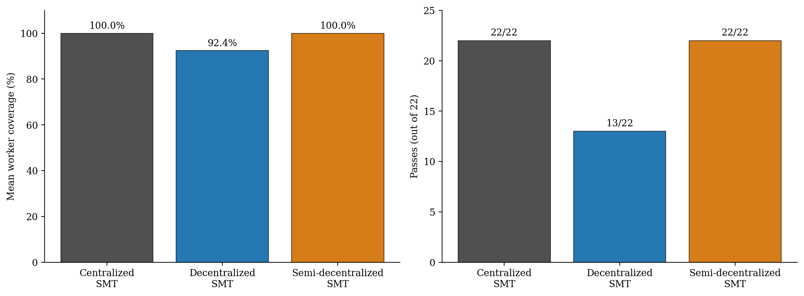
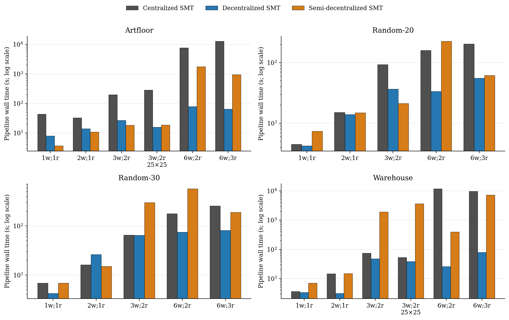
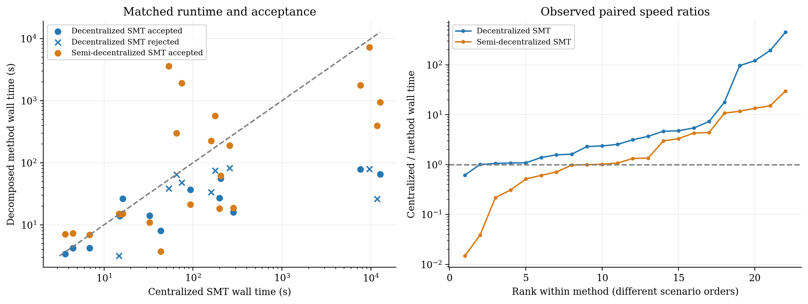
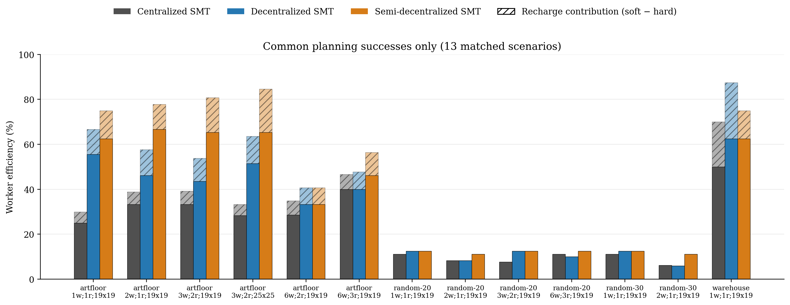
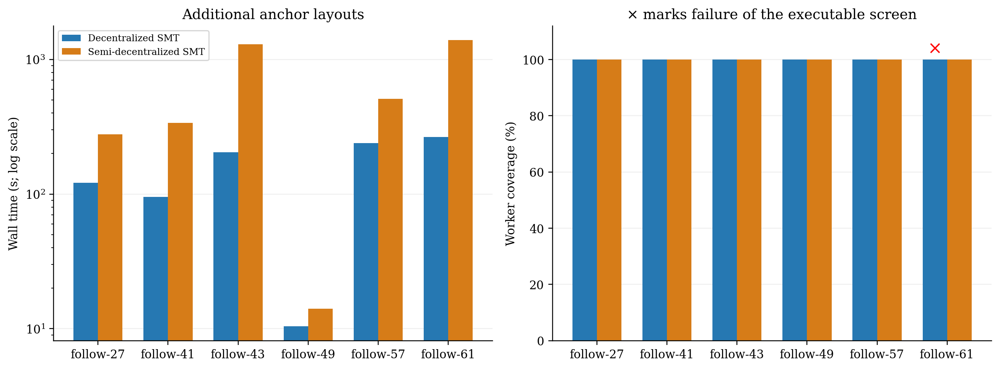
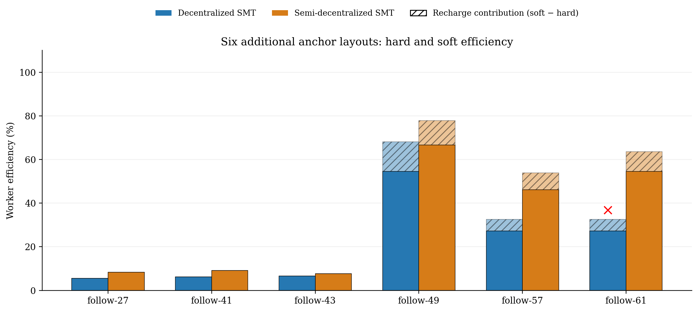

# Decentralized and semi-decentralized SMT planning: methods and experimental comparison

## Overview

This report explains two mobile-recharger planning methods and compares their completed experimental results with a centralized SMT baseline. **Decentralized SMT (Version A)** assigns workers through local negotiation. **Semi-decentralized SMT (Version B1)** uses a central assignment optimizer followed by local schedule planning. Both use Z3 to solve movement, battery, recharge and collision constraints.

Across 22 matched base scenarios, centralized and semi-decentralized SMT pass all 22 cases; decentralized SMT passes 13. Median recorded planning-pipeline times are 84.10, 41.37 and 30.30 seconds, respectively. Semi-decentralized SMT also passes all six additional anchor layouts. Its main observed advantage is complete coordinated service, accompanied by several long planning runs.

## 1. Problem and common planning stages

Worker robots repeatedly follow prescribed loops and consume battery while moving. Mobile rechargers travel through an obstacle map and replenish workers at compatible positions and times. The inputs include worker loops, energy requirements, battery capacities, recharge rate, recharger motion primitives, starting anchors and a requested horizon T. The output must specify worker actions and recharger trajectories that form a repeatable schedule.

An **anchor** is a recharger's physical starting location. A **group** contains one recharger and its assigned workers. A **planning region** bounds that group's local search. The solver may select a different starting position for the repeating schedule, so a separate setup stage routes the recharger there.

The default local solver uses two shots:

1. **Phase 1: select the initial schedule.** For horizon T, jointly choose worker movement, waiting and recharge decisions and recharger motion. Enforce the encoded energy, movement, obstacle and enabled collision constraints. Minimize worker waiting. A failed phase 1 provides no schedule for phase 2 to complete.
2. **Phase 2: complete the selected schedule.** Fix the chosen phase-1 worker schedule and recharge appointments, then solve the remaining completion requirements through an extended horizon M, also written T'. An independent group searches increasing M within a bounded budget; an aligned group checks the required M. A candidate below the completion lower bound can be skipped. The stored repeating period is M minus 1 because the endpoint repeats the start.

For worker i, let k_i,t be its loop index, b_i,t its battery, B_i its capacity, and e_i,k the cost of advancing from loop index k. Phase 1 starts with a full battery and loop index 1. Moving advances the index cyclically, while waiting and charging preserve it. The corresponding battery updates are:

$$
b_{i,t+1}=b_{i,t}-e_{i,k_{i,t}}\ (\mathrm{move}),\qquad b_{i,t+1}=b_{i,t}\ (\mathrm{wait}),\qquad b_{i,t+1}=b_{i,t}+c_{i,t}\ (\mathrm{charge}).
$$

The constraints require 0 <= b_i,t <= B_i and 1 <= c_i,t <= delta, where delta is the maximum recharge amount per transition. A charging worker must be adjacent to its assigned stationary recharger. Recharger primitives update positions by their displacements; their translated swept cells must remain free, within the region, and clear of the enabled collision reservations. Workers return to their loop-start positions by T. Phase 1 minimizes:

$$
J_{\mathrm{wait}}=\sum_i\sum_{t=1}^{T-1}\mathbf{1}[u_{i,t}\ne\mathrm{move}].
$$

Here u_i,t is the action and the indicator equals one when its condition is true. Both charging and idle transitions count as non-work. For phase 2, let h_i be the last state where the worker's battery changed. Its final charging duration and the implementation's completion lower bound are:

$$
d_i=\left\lceil\frac{B_i-b_{i,h_i}}{\delta}\right\rceil,\qquad M_{\mathrm{lower}}=\max_i h_i+\max_i d_i.
$$

Each selected intermediate appointment fixes the recharger's cell at both ends of that charging transition. Final charging selects one start s_i in [h_i, M-d_i] and holds a recharger beside the worker's loop start for d_i+1 states. Phase 2 preserves the recharger's selected initial position and requires q_r,M = q_r,1. Unaligned M candidates start at max(T, M_lower); an aligned M below the bound is skipped.

Two-shot planning does not jointly optimize all possible phase-1 choices and final cycles. A schedule with minimal initial waiting may be expensive to complete. This explains the need for horizon retries and, in B1, possible regrouping. The optional phase-2 primitive-cost objective is disabled in the compared experiments.

Both methods coordinate overlapping groups in a **wavefront**. Lower recharger IDs have priority. Earlier plans become time-indexed occupied and swept-cell reservations that later overlapping groups must avoid. Compatible upstream periods determine alignment. Groups in the same dependency level can solve concurrently; disjoint groups do not automatically share a cycle.

## 2. Decentralized SMT: Version A

### Discovery and assignment

Each recharger constructs a square, map-clipped region around its anchor and exchanges beacons with nearby agents. Workers broadcast route information to agents whose regions intersect their loops. Eligibility is stricter than merely hearing a worker: its entire loop must fit inside the agent's region, and local reachability and service estimates must be finite.

For anchor a_r and radius R_s, the free-cell planning region and communication radius are:

$$
\mathcal{B}_r=\{(x,y)\in\mathcal{F}:\max(|x-a_{r,x}|,|y-a_{r,y}|)\leq R_s\},\qquad R_c=2R_s.
$$

An agent runs breadth-first search over valid motion primitives, rejecting any transition whose swept footprint leaves this region or hits an obstacle. D_r(v) is the shortest resulting travel distance to a free charging cell adjacent to worker position v.

To score worker i, the agent subtracts successive loop movement costs from its charge until the next move would be unaffordable; call the number of affordable moves tau_i. It scans loop occurrences k = 0 through tau_i for the first with D_r(v_i,k) <= k and uses that distance as t_arr. If none qualifies, it uses the distance to the depletion position when reachable. The service score is:

$$
S_{ri}=u_1\max(0,t_{\mathrm{arr}}-\tau_i)+u_2t_{\mathrm{arr}}+u_3\max(0,\tau_i-t_{\mathrm{arr}}).
$$

The terms penalize late arrival, travel and earliness, with default weights 1, 0.1 and 0.01. With mean movement cost ebar_i and mean reachable loop charging distance Dbar_ri, workload is estimated as:

$$
U_{ri}=\frac{\bar e_i}{\delta}+\frac{\bar e_i}{B_i}\bar D_{ri}.
$$

Agents exchange current membership and scores, then negotiate through these active rounds:

- **Claim:** an agent with complete neighbor information claims at most one eligible worker per round. The smallest lexicographic bid wins: group size first, then resulting estimated workload, service score, and recharger ID.
- **Rebalance and reclaim:** feasible offloads or exchanges create room for an unclaimed worker, followed by another claim round. This runs for K_unclaimed cycles, default 10.
- **Swap:** transfers and exchanges improve the two-group balance tuple below, or keep it tied while reducing total service score. Both agents vote on the proposed before/after memberships; a matching vote and delivered commit apply the ownership change.

For current membership G_r, the bid and pairwise balance tuple are:

$$
\mathrm{bid}_{ri}=\left(|G_r|,\ \sum_{j\in G_r}U_{rj}+U_{ri},\ S_{ri},\ r\right).
$$

$$
C_{rs}=\left(|G_r|^2+|G_s|^2,\ \left(\sum_{i\in G_r}U_{ri}\right)^2+\left(\sum_{i\in G_s}U_{si}\right)^2\right).
$$

Unclaimed workers receive the applicable reason: outside all regions, whole loop not contained, unreachable service or incomplete negotiation. The evaluated setup imposes no worker-count cap.

### Planning, fallback and final checks

Each group runs the local solver in its wavefront level. An unaligned group initially uses T. An aligned group tries up to K_T descending phase-1 horizons, starting from min(T, M), with no candidate below 4.

An overlap creates a dependency from lower ID r to higher ID s. A source group has level zero; otherwise its level is one plus the largest predecessor level. Groups at one level can be solved together. Earlier trajectories are clipped to the later group's region and converted into time-indexed reservations. Live predecessors must have a common period M_r-1 to align the later group. Its retry sequence is:

$$
T_k=\min(T,M)-k,\qquad 0\leq k<K_T,\qquad T_k\geq4.
$$

If aligned planning fails while neighbor reservations exist, Version A may retry without those reservations and without the fixed M. Missing or incompatible upstream plans may also lead to independent planning. A successful candidate produced under a dependency problem is marked **fallback**. It can satisfy its local constraints while conflicting with another group, so fallback is not counted as a complete accepted plan in the comparison.

A fallback candidate is stored with its flag and published through the normal plan-message path. The verifier checks it together with other plans; there is no separate automatic fallback-repair stage. UNKNOWN stops the local retry path before any independent fallback solve.

Recovery is triggered separately when exhausted acknowledgement retries identify an unreachable recharger. Its modeled stop cell becomes an obstacle, and its anchor, group and plan are removed. Surviving agents update their locally sensed maps and recompute candidates. They rerun the same negotiation using surviving memberships so eligible workers without a surviving owner can be claimed again. Membership or local-map changes mark an agent's plan dirty; dirty or missing higher-priority notices propagate replanning to dependent agents. The wavefront re-solves that dirty set while retaining unchanged plans, then reports reassigned and unserved workers.

Finally, verification repeats the saved periods over min(lcm(M_r-1), 3000) steps and tests cell/sweep intersections for pairs involving rechargers. Setup uses a time-expanded primitive search from each physical anchor to its selected cycle start, reserving earlier setup paths and stationary worker starts. Neighbor readiness propagates by logical AND, and component finishing times by MAX, before opening the start barrier.

## 3. Semi-decentralized SMT: Version B1

### Global assignment and group-specific regions

A central Z3 optimizer evaluates eligible worker/recharger pairs across the map. Binary x_ri represents assigning worker i to recharger r. Ineligible pairs are omitted; no worker can have multiple owners:

$$
\sum_r x_{ri}\leq1,\qquad A=\sum_{r,i}x_{ri},\qquad A\geq A_{\mathrm{previous}}\ \mathrm{on\ retries}.
$$

Define charging demand rho_i = ebar_i/delta. The optimizer computes group count n_r, charging load L_r and battery-weighted workload U_r as:

$$
n_r=\sum_i x_{ri},\qquad L_r=\sum_i\rho_i x_{ri},\qquad U_r=\sum_i x_{ri}\left(\rho_i+\frac{\bar e_i}{B_i}\bar D_{ri}\right).
$$

Let D_ij be the symmetric mean nearest-loop distance between charging neighborhoods. For each group, the service effort F_r includes charging during T, a round-trip travel proxy O_r, and within-group pair travel. Spatial cost also includes anchor travel:

$$
F_r=T L_r+2O_r+\sum_{i<j}D_{ij}x_{ri}x_{rj},\qquad O_r\geq0,\quad O_r\geq\bar D_{ri}x_{ri}.
$$

$$
C_{\mathrm{space}}=\sum_{r,i}\bar D_{ri}x_{ri}+\sum_r\sum_{i<j}D_{ij}x_{ri}x_{rj}.
$$

Products of assignment variables are encoded as logical conjunctions. The objectives are solved lexicographically in this order:

$$
\min_{\mathrm{lex}}\left(-A,\ C_{\mathrm{keep}},\ \max_r F_r,\ \sum_r U_r,\ C_{\mathrm{space}},\ \sum_{r<s}|U_r-U_s|,\ \sum_{r<s}|L_r-L_s|,\ \sum_r n_r^2\right).
$$

C_keep is included only during recovery with a previous assignment and a nonempty focus; it counts ownership changes outside the failed dependency neighborhood. Final deterministic ownership tie-breaks follow these objectives. Earlier objectives take priority, so improving count balance cannot reduce maximal coverage.

These estimates favor geographically coherent, manageable groups. An OPTIMAL assignment proceeds to timed local scheduling.

Each group receives a region built from its anchor, worker loop sweeps, charging neighborhoods and traced primitive paths to reachable charging locations, with small padding. This adapts the region to the assignment. The resulting region overlaps define the wavefront dependencies.

### Completion-aware scheduling and bounded recovery

B1 preserves upstream reservations. A missing, failed or incompatible upstream plan blocks the dependent group; it does not cause an unconstrained fallback.

Its phase-1 primary objective is still minimum waiting. Among equally good waiting schedules, additional objectives prefer smaller estimated worst and total completion effort, smaller residual recharge deficits and lower initial recharger primitive cost. The estimates account for obstacles but approximate ordering and dynamic interactions, so phase 2 still checks actual feasibility. This is an important difference from Version A beyond grouping alone.

For a one-recharger group, the completion estimate uses obstacle-aware travel to the worker's starting charging neighborhood, residual charging time, and return travel to the selected recharger cycle start:

$$
\widehat d_i=\left\lceil\frac{B_i-b_{i,T}}{\delta}\right\rceil,\qquad \widehat C_i=D(q_{r,T},L_i[1])+\widehat d_i+D(L_i[1],q_{r,1}).
$$

D measures travel to/from free charging neighbors, rather than the worker's occupied cell. After minimizing waiting, the tie-breaking objectives are:

$$
\min_{\mathrm{lex}}\left(\max_i\widehat C_i,\ \sum_i\widehat C_i,\ \sum_i\widehat d_i,\ \sum_r\sum_{t=1}^{T-1}\mathrm{cost}(p_{r,t})\right).
$$

For aligned jobs, B1 tries at most min(K_T, 2) phase-1 horizons. If planning fails, it can retime the affected overlap components using a target equal to the largest relevant successful or previously forced M plus 4. Each assignment receives at most three wavefront passes: the initial pass and two extensions. Changed schedules are solved again. Successful jobs are reused only when all planning inputs match, including reservations and horizon.

The affected set consists of overlap components touching failed groups. A successful affected plan must provide a reference cycle before extension is attempted:

$$
M_{\mathrm{new}}=\max(\{M_r:r\ \mathrm{live\ and\ affected}\}\cup\{M_r^{\mathrm{forced}}:r\ \mathrm{affected}\})+4.
$$

After verification and setup, an executable result ends the search. Otherwise, B1 may exclude the exact attempted assignment and request another one, preserving achieved assignment coverage as a lower bound. It prefers avoiding unnecessary ownership changes outside the failed dependency neighborhood. The default permits five additional regroupings, giving at most six assignment attempts.

UNKNOWN is inconclusive and stops the relevant recovery path. Workers with no geometric candidate are reported as unreachable. Bounded retry exhaustion does not prove that every possible schedule is impossible. B1's regrouping happens offline; it does not invoke Version A's online runtime arbiter.

## 4. Pseudocode

The helper TWO_SHOT runs phase 1 followed by phase-2 completion, returning a schedule, a bounded failure or UNKNOWN. TRY_HORIZONS stops on success or UNKNOWN. These algorithms summarize the implemented control flow; detailed negotiation, setup and constraint encodings are represented by named procedures.

### Decentralized SMT

```text
PROCEDURE DECENTRALIZED_SMT(instance, anchors, parameters)
    agents ← CREATE_REGIONAL_AGENTS_AND_DISCOVER_NEIGHBORS()
    candidates ← CHECK_LOOP_ELIGIBILITY_AND_REACHABILITY(agents)
    groups ← NEGOTIATE_CLAIMS_TRANSFERS_AND_SWAPS(candidates)
    unclaimed ← EXPLAIN_UNASSIGNED_WORKERS(groups)

    FOR level IN PRIORITY_LEVELS_OF_OVERLAPPING_REGIONS DO
        FOR EACH group IN level IN PARALLEL WHEN ENABLED DO
            reservations, M, reason ← READ_UPSTREAM_PLANS(group)
            IF upstream dependency is missing or incompatible THEN
                reservations ← NONE; M ← NONE
            horizons ← DESCENDING_ALIGNED_HORIZONS_OR_T(T, M, K_T)
            result ← TRY_HORIZONS(TWO_SHOT, group, horizons,
                                  reservations, M, variant = A)
            IF result failed AND result is not UNKNOWN
               AND reservations exist THEN
                result ← TWO_SHOT(group, first(horizons), NONE, NONE, A)
                reason ← ALIGNMENT_FAILED
            RECORD_AND_PUBLISH(result,
                fallback = result succeeded AND reason exists)

    result ← ASSEMBLE_AND_VERIFY(groups, plans, unclaimed)
    IF failed acknowledgements identify failed rechargers THEN
        result ← RECOVER_VERSION_A_MISSION(result)
    result.setup ← PREPARE_SETUP_AND_COORDINATE_START(result)
    RETURN result
END PROCEDURE
```

### Semi-decentralized SMT

```text
PROCEDURE SEMI_DECENTRALIZED_SMT(instance, anchors, parameters)
    excluded ← empty; required_coverage ← 0; cache ← empty
    previous ← NONE; focus ← empty
    FOR attempt ← 0 TO max_regroupings DO
        groups ← OPTIMIZE_GLOBAL_ASSIGNMENT(
            excluded, required_coverage, previous, focus)
        IF grouping status is not OPTIMAL THEN RETURN diagnostics
        required_coverage ← assigned worker count
        forced_horizons ← empty

        FOR cycle_attempt ← 0 TO 2 DO
            regions ← BUILD_REGIONS_FROM_ASSIGNED_GEOMETRY(groups)
            plans ← RESERVED_WAVEFRONT_TWO_SHOT(
                groups, regions, forced_horizons, cache,
                aligned horizon budget = min(K_T, 2), variant = B1)
            IF assigned groups are valid AND no verified conflicts
               AND joint period is within limit THEN BREAK
            failed ← groups with workers but no valid plan
            affected ← OVERLAP_COMPONENTS_TOUCHING(failed)
            IF no failed group OR no live affected reference cycle
               OR a failed solver result is UNKNOWN THEN BREAK
            target ← largest relevant live/forced M + 4
            FORCE target FOR affected groups

        result ← VERIFY_AND_PREPARE_SETUP(groups, plans)
        IF result is executable THEN RETURN SUCCESS(result)
        IF any local solver returned UNKNOWN THEN RETURN UNKNOWN(result)
        IF workers remain unassigned THEN RETURN UNREACHABLE(result)
        previous ← groups
        focus ← failed groups and direct overlapping neighbors
        EXCLUDE exact groups assignment
    RETURN latest result with RETRY_LIMIT_REACHED
END PROCEDURE
```

The reserved B1 wavefront blocks missing dependencies, retains upstream reservations, and reuses cached successes only for identical complete jobs. Empty groups remain parked. Both algorithms enforce the minimum phase-1 horizon of 4 for alignment retries.

## 5. Experimental comparison

The evaluation contains **22 matched base scenarios** across artificial-floor, warehouse, Random-20 and Random-30 maps, with 19×19 and padded 25×25 grids. Requested T is 8. Six additional anchor layouts compare the two proposed methods separately. They are different layouts, not timing repetitions.

The centralized baseline is the project's Python/Z3 two-shot implementation, which solves all workers and rechargers together. For this report, a returned SAT centralized result with full coverage and no reported conflicts counts as a pass. The two proposed methods use their recorded acceptance checks, including complete coverage, no conflicts or fallback, and the executable result. No separate deployment-ready comparison is presented.

### Coverage and computation

| Method | Base cases passed | Mean worker coverage | Median pipeline time |
| --- | --- | --- | --- |
| Centralized SMT | 22/22 | 100.00% | 84.10 s |
| Decentralized SMT (A) | 13/22 | 92.42% | 30.30 s |
| Semi-decentralized SMT (B1) | 22/22 | 100.00% | 41.37 s |



**Figure 1.** Mean worker coverage and accepted scenario counts for the 22 base cases, using the acceptance rules stated above.

Decentralized SMT has six partial base results and three full-coverage fallback results. Its short computation times must therefore be read alongside incomplete acceptance. B1 achieves the same base pass count as centralized SMT, while using global assignment followed by coordinated local solving.

Runtime variability remains substantial. B1's warehouse 6-worker/3-recharger case takes 7238.80 seconds, about two hours. Its warehouse 3-worker/2-recharger cases take 1924.13 seconds on the original grid and 3620.71 seconds on the padded grid. A low median does not imply a reliable planning deadline.

Across all 22 base pairs, decentralized SMT finishes sooner than centralized SMT in 21 cases, and B1 in 13. Median observed centralized/method time ratios are 2.85 and 1.20. These include rejected decentralized results. On the 13 common successful cases, the median paired ratios are 2.55 and 3.32, respectively.



**Figure 2.** Recorded pipeline times by workspace and worker/recharger count (w/r). Time uses a logarithmic scale. Labels identify the padded 25×25 cases; other cases use 19×19 grids. Rejected and partial results remain in this timing comparison.



**Figure 3.** Left: points below the diagonal finish faster than the matched centralized run; crosses mark rejected results. Right: centralized/method time ratios above one favor the decomposed method. Ratios are sorted independently, so ranks do not identify the same scenario across methods.

### Efficiency at equal successful service

Hard efficiency credits productive worker activity; soft efficiency additionally credits the implementation's counted recharge contribution. If a 20-step schedule contains 12 work steps, 4 recharge steps and 4 idle steps, hard efficiency is 60% and soft efficiency is 80%. Grouped results use worker-horizon weighting. These schedule metrics are not measured physical utilization.

For accepted groups, let n_r be worker count, J_wait,r the phase-1 non-work total, and Q the implementation's total counted recharge contribution. Extending from T_r to M_r adds n_r(M_r-T_r) non-work units. The aggregation is:

$$
D=\sum_r n_rM_r,\qquad H=\sum_r\left(J_{\mathrm{wait},r}+n_r(M_r-T_r)\right).
$$

$$
\eta_{\mathrm{hard}}=100\frac{D-H}{D},\qquad \eta_{\mathrm{soft}}=100\frac{D-H+Q}{D}.
$$

Q counts selected intermediate charging transitions and the final recharge durations. These formulas explain the graphs: solid height is hard efficiency, the hatched addition is 100Q/D, and total height is soft efficiency.

Only the **13 scenarios passed by all three methods** are used in the following quality comparison:

| Method | Mean hard efficiency | Mean soft efficiency |
| --- | --- | --- |
| Centralized SMT | 22.63% | 26.82% |
| Decentralized SMT (A) | 30.34% | 36.89% |
| Semi-decentralized SMT (B1) | 36.47% | 43.27% |



**Figure 4.** Efficiency on the 13 common successful base scenarios. Solid height is hard efficiency; the hatched addition is the recharge contribution. Total bar height is soft efficiency. Grey denotes centralized, blue decentralized, and orange semi-decentralized SMT.

B1's hard-efficiency advantage over A is 6.14 percentage points on this matched subset. Global grouping, adaptive regions and completion-aware phase-1 choices are plausible contributors. The experiments do not isolate their individual causal effects.

Centralized SMT is not inherently guaranteed to have lower efficiency. In this implementation, phase 2 completes a fixed phase-1 choice; extending the common horizon can add worker waiting. Local groups can obtain different cycles, and their efficiencies are aggregated across those cycles. These structural differences help explain how decomposed methods can outperform the evaluated centralized schedule without contradicting a global optimality guarantee: this two-shot baseline provides no such joint guarantee.

### Six additional anchor layouts

| Method | Additional layouts passed | Total passed, including base |
| --- | --- | --- |
| Decentralized SMT (A) | 5/6 | 18/28 |
| Semi-decentralized SMT (B1) | 6/6 | 28/28 |

The rejected decentralized followup has full worker coverage but two reported conflicts. It illustrates why assigning every worker is insufficient to establish coordinated acceptance. These followups have no separate matched centralized runs and are not included in the 13-case efficiency average.



**Figure 5.** Runtime and worker coverage for the six additional layouts. A red × marks a failed acceptance check, even when coverage is 100%. Blue denotes decentralized and orange semi-decentralized SMT.



**Figure 6.** Hard and soft efficiency for the six additional layouts, which are excluded from Figure 4. Solid height is hard efficiency; the hatched section extends it to soft efficiency. The red × identifies a rejected candidate whose recorded efficiency is shown for completeness. Matched centralized followup results are unavailable.

## 6. Interpretation and conclusions

Version A provides a local, message-based assignment strategy and usually returns candidates quickly. Its fixed regional eligibility and coordination failures can leave workers unserved or produce flagged fallback plans. B1 addresses assignment globally, adapts local regions to assigned routes, favors easier cycle completion, and keeps neighbor reservations during recovery. In this suite, that combination achieves complete accepted service across every tested layout.

B1's stronger completion results come with extra optimization and retry costs. Centralized SMT also passes every base case, but some large joint solves are slow and its selected two-shot schedules have lower measured efficiency. The evidence supports a service-versus-computation tradeoff rather than a universal ranking across every instance and metric.

Each configuration has one observation. Historical centralized timings and newer notebook runs are not controlled hardware repetitions; pipeline contents and parallelism differ. The 25×25 cases pad the existing geometry, so they describe workspace-boundary sensitivity rather than independently generated larger environments.
