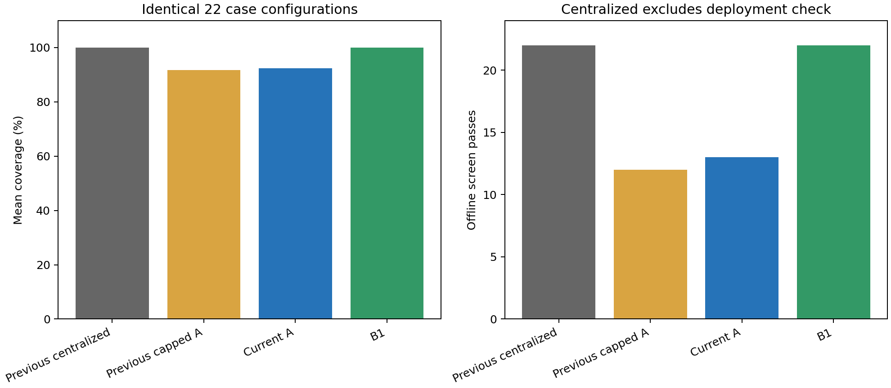
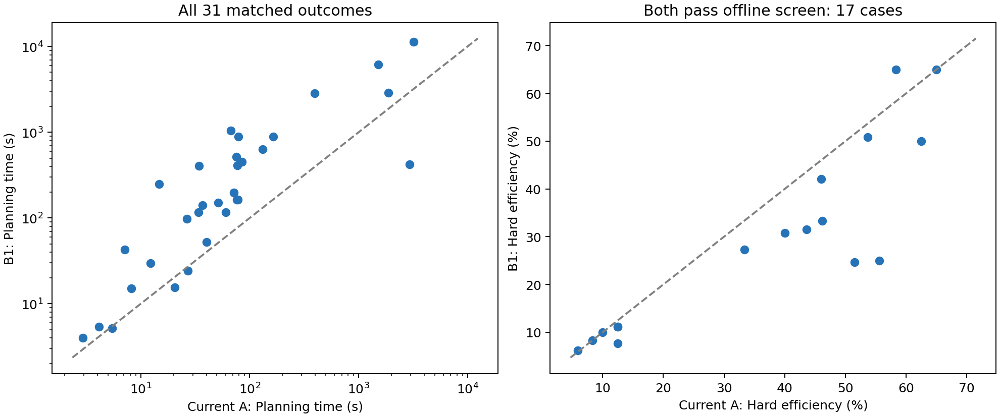

# Current Version A, B1, previous capped A, and previous centralized comparison

Analysis date: 16 November 2026. All findings use saved completed outputs; no benchmark was rerun.

## Main finding

**B1 has the strongest observed service completeness. Current A generally plans faster and achieves higher worker efficiency when its offline plan passes the checks. Removing the cap helps two artfloor configurations, but leaves most coverage and coordination failures unresolved.** The previous centralized implementation also serves all workers on its matching completed cases. B1 offers substantial planning-time reductions on several difficult six-worker centralized cases, with lower efficiency in most of those examples.

These conclusions apply to the tested configurations. They do not establish a universal ranking, real robot performance, or a causal benefit from central grouping alone.

## Data audit and comparison scope

The new folder contains **63 completed result JSONs**, matching all 63 rows of `results_all_batches.csv`. There are no duplicate job IDs and **zero CSV/JSON discrepancies**. There are 32 current A outputs and 31 B1 outputs, forming **31 complete pairs**.

**Job 14 is missing:** B1, artfloor, 19×19, six workers, two rechargers, T=14. Its current A counterpart, job 13, is retained in the A-versus-historical comparison but excluded from A/B1 paired statistics. A stopped log without a result contributes no runtime, failure, or quality observation. The reason for stopping cannot be inferred from the absence of a result.

Completed T14 and 25×25 cases are included. The saved data contain 19 completed T14 outputs: ten A and nine B1. They also contain four new 25×25 outputs: both methods on artfloor and warehouse, three workers/two rechargers. The folders named random-20 and random-30 use 19×19 grids here.

The historical source is `mrp_backup/study-20261114-180038`. Matches use dataset, grid, worker count, recharger count, and requested T. Historical A results are exactly the source jobs selected by the new suite manifest, and their saved anchors match the manifest. Only historical `base`, `cost_off_small`, and matching `T14` configurations are controls; collision-disabled, cost-optimized, radius, refinement, and alternative-cap variants are not mixed into the default comparison.

- **32** current A / previous capped A pairs.
- **31** current A / B1 pairs.
- **22** configurations with all four methods available: all use T=8; 20 are 19×19 and two are 25×25.
- There is no matching historical centralized T14 control. No centralized T14 performance is imputed.

The suite deduplicated historical parameter variants into distinct input configurations. It therefore measures current default A and B1 on those configurations; it does not repeat every earlier algorithm variant.

## What counts as an accepted offline plan

For A and B1, an offline screen pass requires full worker coverage, zero recorded conflicts, no fallback groups, deployment `READY`, and a complete joint cycle within the verifier's 3,000-step limit. The recorded `executable` flag is checked against the joint period. All compared joint periods are below the limit; the maximum across these observations is 1,680.

For the previous centralized method, the screen requires full coverage and zero recorded conflicts. **Its deployment is not modeled**, so a centralized pass does not establish deployment readiness equivalent to A or B1.

The current A runner labels a result `SAT` when coverage is 100%, even if it uses fallback. Of A's 32 results, 23 say `SAT`, but only **18 pass** the screen. Nine are partial; five have full coverage but use fallback. Across all A outputs, nine runs use fallback and one run has recorded conflicts. All 63 new results report deployment `READY`; readiness alone does not establish a safe repeating plan.

The conflict checker checks interactions involving rechargers and deliberately skips worker-versus-worker pairs. Zero conflicts therefore means zero under that checker and the supplied swept-path model. It is not a claim that every possible physical collision has been excluded.

Hard and soft efficiency are the implementation's worker waiting-time metrics. They use worker-horizon weights over successful groups. Partial results do not receive a full-system efficiency comparison. Different group periods also make these metrics different from a measured synchronized ROS2 throughput. Primitive cost is a total over saved cycles, whose lengths can differ; it is not a normalized long-run cost rate. Phase 2 cost optimization is off in the main comparisons.

## All four methods on the same 22 configurations

| Method | Full coverage | Mean coverage | Offline screen passes | Median planning time |
| --- | ---: | ---: | ---: | ---: |
| Previous centralized | 22/22 | 100.00% | 22/22* | 84.10 s |
| Previous capped A | 15/22 | 91.67% | 12/22 | 29.42 s |
| Current A | 16/22 | 92.42% | 13/22 | 34.15 s |
| B1 | 22/22 | 100.00% | 22/22 | 116.63 s |

*Centralized deployment is not modeled. Planning time includes partial and fallback outcomes, so the median columns alone are not an equal-service speed comparison.*

Restricting to the **20 original 19×19 configurations** preserves the pattern: mean coverage is 100% centralized/B1, 90.83% capped A, and 91.67% current A. Screen counts are 20, 20, 11, and 12 respectively. Thus the coverage finding is not caused by including 25×25 cases.

There are **12 configurations where all four methods pass their respective screens**. On that common quality subset:

| Method | Mean hard efficiency | Mean soft efficiency | Median planning time | Mean primitive cost per saved cycle |
| --- | ---: | ---: | ---: | ---: |
| Previous centralized | 22.13% | 26.14% | 38.04 s | 69.42 |
| Previous capped A | 30.09% | 36.57% | 12.87 s | 43.00 |
| Current A | 30.09% | 36.57% | 17.62 s | 43.00 |
| B1 | 20.81% | 24.72% | 36.14 s | 69.58 |

This subset shows A's quality advantage on cases it handles successfully. It excludes difficult cases where A cannot provide an accepted plan, and must be presented together with the coverage table.

## Current A versus B1: 31 completed pairs

B1 covers all workers and passes the offline screen in **31/31** paired cases. Current A's mean coverage is **92.47%**, with **17/31** screen passes. B1 increases coverage in nine cases; in another five it replaces full-coverage fallback outputs with accepted plans. Its observed acceptance advantage is therefore 14 additional cases among these 31.

Over all paired outcomes, the median B1/A time ratio is **3.41×**. This includes cases in which A served fewer workers or returned fallback, so it does not measure equivalent service.

On the **17 cases where both pass**:

- B1 takes a median **2.40×** A's planning time; B1 is faster in three cases.
- B1's mean hard efficiency is **6.91 percentage points lower**, and soft efficiency **8.94 points lower**.
- B1 has higher hard efficiency in two cases, equal efficiency in three, and lower efficiency in twelve.
- B1's mean saved-cycle primitive cost is **23.71 higher**. Different periods and disabled cost optimization prevent interpreting this as an energy-rate penalty.

B1's lower efficiency is consistent with its design and the observed horizons. Its grouping optimizer prioritizes assigned workers, worker-count balance, demand balance, and anchor-to-loop distance. It does **not** optimize the final worker waiting-time metric or jointly optimize grouping with both planning phases. It accepts the first executable partition encountered by its retry pipeline. Moreover, B1 has full-map planning scope, whereas A uses radius six; that also changes allowed recharger starts, reservations, and the SMT search. A larger feasible region does not guarantee a better output from this two-stage procedure.

For example, artfloor W1/R1 has exactly the same worker ownership in A and B1, yet A returns M=9 and hard efficiency 55.56%, while B1 returns M=20 and 25.00%. This difference cannot be attributed to load balancing between groups. It shows that planning scope and the selected two-shot schedule also matter. For artfloor W6/R3/T14, B1 instead improves hard efficiency from 58.33% to 65.00%, with both returning M=20: horizon alone does not determine efficiency either.

## Effect observed after removing the cap

The previous capped A and current A have **32 exact input/anchor matches**. Current mean coverage rises from **91.67% to 92.71%**, and screen passes from **16/32 to 18/32**.

| Configuration | Previous capped A coverage | Current A coverage | Previous/current time | Current screen |
| --- | ---: | ---: | ---: | --- |
| Artfloor, 19×19, W6/R2, T=8 | 83.33% | 100.00% | 38.72 / 78.99 s | Pass |
| Artfloor, 19×19, W6/R2, T=14 | 83.33% | 100.00% | 146.13 / 216.39 s | Pass |

No coverage or screen result changes in the other 30 cases. In the 16 cases where both A versions pass, hard efficiency, soft efficiency, and total primitive cost are unchanged. Current A's median paired time ratio is 1.10 across all 32 pairs and 1.13 on the 16 accepted pairs. These small timing differences are not evidence of a stable algorithmic slowdown under uncontrolled Colab hardware.

The two improvements are consistent with lifting the workload limit. However, several source changes occurred between studies, and the old executable environment was not rerun under a controlled ablation. The results establish the observed before/after difference, not proof that cap removal was its only cause.

Current A still has nine partial cases. Their saved unclaimed reasons are geometric: `outside_all_regions` or `loop_not_inside_any_region`. Removing a workload cap cannot make those loops admissible under radius-six region rules. Separately, fallback means a group could not maintain the required neighbor-constrained plan and returned an unconstrained alternative. B1's full-map scope and partition retries address different restrictions from a capacity limit.

The most serious recorded A result is **job 45**, random-30 W6/R3/T14: 83.33% coverage, fallback groups 2 and 3, and **85 cross-group conflict records**. Those are time-indexed records, not necessarily 85 distinct physical collision events. It is excluded from accepted-plan quality comparisons.

## B1 versus previous centralized

On the same **22 cases**, both have 100% coverage and pass their respective offline screens. The median paired B1/centralized time ratio is **0.945×**; B1 is faster in **12/22** cases. Its mean hard efficiency is **1.64 percentage points lower**, and soft efficiency **1.99 points lower**. Hard efficiency improves in one case, ties in nine, and decreases in twelve.

Performance varies substantially by map. For six workers at T=8:

| Dataset | Rechargers | Previous centralized time | B1 time | Centralized/B1 time ratio |
| --- | ---: | ---: | ---: | ---: |
| Artfloor | 2 | 7,602.05 s | 885.68 s | 8.58× |
| Artfloor | 3 | 12,664.76 s | 197.37 s | 64.17× |
| Warehouse | 2 | 11,735.50 s | 404.10 s | 29.04× |
| Warehouse | 3 | 9,621.52 s | 409.19 s | 23.51× |
| Random-20 | 2 | 160.33 s | 115.97 s | 1.38× |
| Random-20 | 3 | 204.41 s | 163.38 s | 1.25× |
| Random-30 | 2 | 177.99 s | 519.82 s | 0.34× |
| Random-30 | 3 | 257.33 s | 454.56 s | 0.57× |

B1 therefore reduces the largest recorded centralized costs on artfloor/warehouse, but is slower on the two random-30 six-worker cases. The previous centralized comparator is the project's Python/Z3 two-shot implementation, not a new run of the paper repository's original C++ program. Neither this two-shot baseline nor B1 is a global end-to-end efficiency optimizer.

For current A versus centralized, 13 of the 22 pairs pass both screens. On those, current A is faster in 11 cases, with median A/centralized time ratio **0.378×**, and mean hard/soft efficiency gains **7.71/10.07 points**. The nine unaccepted A cases remain part of the service-completeness result.

## T14 cost and B1 retries

| Requested T | Method | Completed outputs | Offline passes | Median time | Sum of recorded time |
| --- | --- | ---: | ---: | ---: | ---: |
| 8 | Current A | 22 | 13 | 34.15 s | 850.20 s |
| 8 | B1 | 22 | 22 | 116.63 s | 4,097.99 s |
| 14 | Current A | 10 | 5 | 304.94 s | 10,581.44 s |
| 14 | B1 | 9 | 9 | 1,046.10 s | 26,355.68 s |

These are descriptive groups with different case compositions, not a controlled T-only average. T is the requested Phase 1 horizon; returned M/T′ values can be larger, and aligned groups may retry lower local T values.

T14 accounts for **86.54% of B1's completed recorded planning time**. B1 job 46, random-30 W6/R3/T14, takes **3.14 hours**, and job 32, random-20 W6/R3/T14, **1.71 hours**. These observations explain why the suite exceeded the earlier rough time expectations. Completed output timing excludes all time spent on interrupted attempts, including the missing job 14.

B1 succeeds on the first partition in 22 cases, the second in seven, and the third in two. Across all 31 B1 outputs, the summed grouping-solver time over recorded attempts is only **17.12 seconds**, versus **30,453.67 seconds** of total pipeline time. The expensive part is local planning and its retries, rather than the small assignment optimization itself. This does not establish scalability to larger workloads.

## What these results support

For the tested inputs, **B1 is the stronger choice when full service and accepted offline coordination are required**. It matches centralized coverage while substantially reducing some difficult centralized planning times. Current A remains attractive for local decision making and efficient plans on feasible regional assignments, but its partial results and fallback cases prevent treating it as an equivalent full-service substitute across this suite. Removing the cap is useful but insufficient to close that gap.

A useful next controlled experiment would hold planning regions and allowed starts equal while changing only grouping, then separately vary region scope. That would distinguish grouping quality from broader reachability and the larger SMT search. Improving B1 efficiency would require evaluating the resulting schedules or scheduling-related costs in its selection process; its current grouping objective provides no final-efficiency guarantee. These are follow-up experiment suggestions, not changes made to the implementations.

All runs use seed zero with one saved observation per job. Hardware, CPU allocation, dependency versions, and competing notebook load were not recorded consistently across the historical/current studies. Runtime ratios are descriptive; no confidence intervals or statistical significance claims are justified. The missing long B1 job also makes completed-only timing susceptible to completion bias. Modeled deployment readiness and collision screens do not establish battery-safe execution under delayed motion, packet loss, or ROS2 control.

The benchmark calls the Python planning pipelines directly with `parallel=False`. It does not run ROS2 nodes or measure middleware traffic, controller behavior, physical charging, or distributed wall time on separate rechargers. Comparable communication counts are not exported for all four methods, so this study makes no communication-overhead ranking. The historical outputs also lack a complete frozen environment and input-content hashes; matching configuration and saved anchors is the strongest available historical match, rather than proof that all software and dataset bytes were identical.

## Reproducible artifacts

- `../analyze_current_comparison.py`: reads only the saved results, checks CSV/JSON agreement and manifest matches, and regenerates tables and plots.
- `audit.json`, `csv_json_discrepancies.csv`: completion and consistency audit.
- `all_completed_case_matrix.csv`: all available observations across all four methods; blanks mean unavailable results.
- `four_method_matrix.csv`, `common_case_summary.csv`, `common_19x19_summary.csv`: identical-case comparisons.
- `all_four_screened_quality.csv`: the common 12-case quality subset.
- `matched_pairs.csv`, `pair_summary.csv`: exact pairs, timing ratios, and accepted-plan quality differences.
- `current_a_rejected.csv`, `b1_retries.csv`, `dataset_summary.csv`: failure reasons' source rows, retry counts, and map summaries.
- `audited_results.csv`: selected raw observations with source paths and screen flags.

Run from the repository folder with `python analysis_results/analyze_current_comparison.py`. This regenerates analysis tables and figures; this written interpretation is maintained separately. The implementation and saved benchmark outputs were not edited, and no commit was made.
