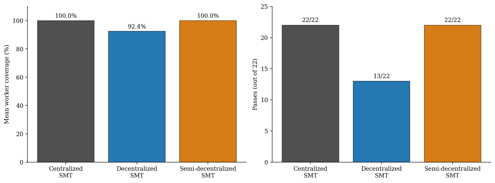
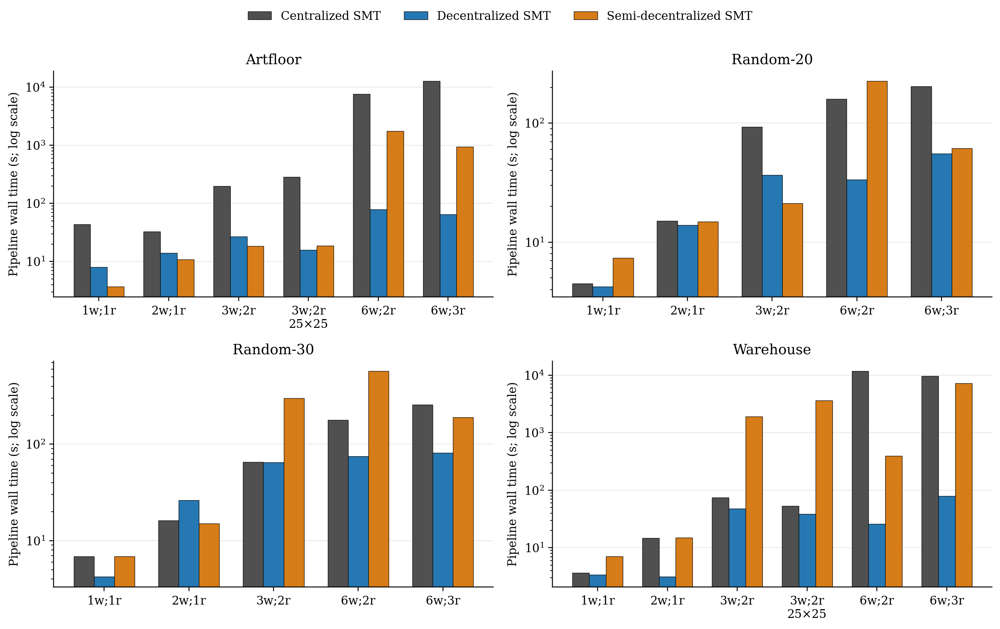
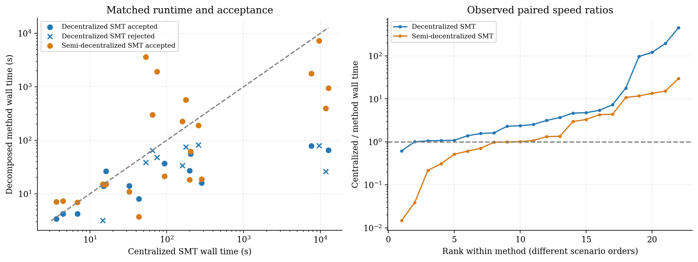
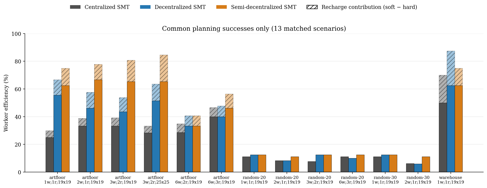
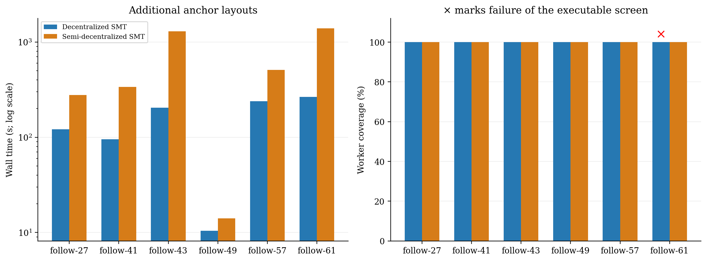
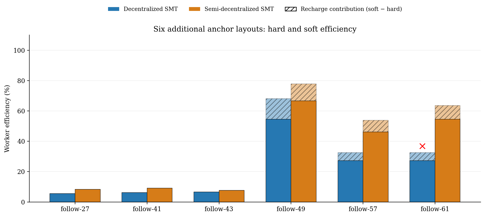

# Comparative study of centralized, decentralized and semi-decentralized SMT planning

## Abstract

This study compares three implementations of mobile recharger planning using 22 matched base scenarios and six additional anchor layouts. Semi-decentralized SMT achieves full worker coverage and passes the executable screen in all 28 tested layouts. Decentralized SMT passes in 18/28 layouts, including 13/22 base scenarios. On the base suite, median pipeline times are 84.10 s for centralized SMT, 30.30 s for decentralized SMT and 41.37 s for semi-decentralized SMT. On the 13 common planning successes, mean hard efficiency is 22.63%, 30.34% and 36.47%, respectively. These observations demonstrate a coverage–computation tradeoff within the tested suite; recorded notebook timings are not controlled hardware benchmarks.

## 1. Problem and methods

Worker robots repeatedly traverse prescribed loops and require mobile rechargers to replenish their batteries. Planning determines worker movement/wait/recharge decisions and recharger trajectories subject to the encoded energy, movement and collision constraints. SMT means satisfiability modulo theories; these implementations use Z3 to solve the encoded constraints.

| Name used in this report | Repository name | Assignment and planning |
| --- | --- | --- |
| Centralized SMT | centralized.py | One two-shot SMT planning problem contains all requested workers and rechargers. There is no decomposition into independently assigned recharger groups. This is the project's Python/Z3 port of the centralized approach. |
| Decentralized SMT | Version A | Rechargers negotiate worker assignments locally, then solve local SMT problems in radius-based planning regions. Overlapping regions are ordered. After alignment failures, a group can drop neighbor reservations and produce a fallback candidate. |
| Semi-decentralized SMT | Version B1 | A central Z3 grouping optimization assigns workers globally; each recharger then solves a local SMT problem in a group-specific region. Overlapping groups respect earlier plans. Bounded cycle retries and global regrouping handle planning failure. |

Both decomposed methods use a wavefront: groups in the same dependency level can plan concurrently; overlapping groups are ordered by priority. Thus semi-decentralized does not mean every local solve is sequential. Its centralized component is worker assignment, followed by local scheduling. Semi-decentralized planning preserves neighbor reservations instead of accepting an unconstrained fallback.

All three evaluated configurations use the **two-shot** method. Phase 1 selects a worker schedule and recharge appointments; phase 2 completes the recharger schedule for that selected solution and searches the allowed extended horizon. This decomposition is not a globally optimal joint scheduler. The optional phase-2 primitive-cost objective is disabled. No one-shot experiment is included here.

## 2. Experimental design and provenance

The new results are the 56 per-job JSON files in `mrp_backup/version_a_b1_parallel`: 28 decentralized and 28 semi-decentralized runs. The primary comparison uses 22 base scenarios, each matched to a completed collision-enabled centralized result in `mrp_backup/study-20261114-180038`. Matching keys are map, grid, worker count, recharger count and requested horizon. The six anchor followups are reported separately because they change the physical anchor layout. Base A/B1 pairs use the same saved anchors. All primary runs request T=8; scenario sizes include 19×19 and padded 25×25 grids. Padding extends the workspace boundary and does not establish scaling to independently generated larger maps.

The 22 base scenarios are the available matched completed suite, not a full factorial or a random sample of all possible instances. Each configuration has one observation, so uncertainty intervals and significance tests are not justified. A/B1 are configured for parallel planning, while centralized times come from earlier notebook sessions. Hardware, runtime load and CPU allocations are not controlled. Timings measure the recorded pipelines, including grouping and setup where implemented. Observed speed ratios should not be read as hardware-independent algorithmic speedups.

The centralized implementation is **not a new execution of the paper's original C++ binary**. The paper informs the two-shot formulation and the visual presentation, not the numerical data in this report. The scenario horizons and experiment matrix differ from the paper's figures.

## 3. Metrics and acceptance rules

Coverage is the fraction of requested workers served by successful plans. A stored SAT result for the decentralized method can still contain fallback or lack an executable coordinated mission. For centralized SMT, a returned SAT result with full coverage and no reported conflicts counts as a **pass**. All 22 centralized results pass. For the two decomposed methods, a pass uses the recorded executable acceptance checks: full coverage, no reported conflicts, no fallback groups, the executable flag and the verifier's 3000-step joint-period limit. These method-specific rules define acceptance in this report; no separate deployment-ready comparison is presented.

Let D be the sum of worker-horizon products across live groups, H their recorded hard waiting total and Q the recharge contribution counted by the implementation. Hard efficiency is 100(D−H)/D; soft efficiency is 100(D−H+Q)/D. The lower stacked bar represents hard efficiency; its hatched addition is soft minus hard, corresponding to the counted recharge contribution. Their sum is soft efficiency. These are schedule metrics, not independently measured physical utilization. Unequal group cycles require worker-horizon weighting.

Quality comparisons use the **same 13 scenarios where all three pass their planning checks**. Raw primitive cost is summed over each recorded cycle, so unequal cycle lengths prevent interpreting it directly as long-run energy consumption. Zero detected conflicts refers to the implemented offline verifier; trajectories are not rerun or physically validated in this study.

## 4. Coverage and completion

| Method | Cases | Passes | Mean coverage (%) | Median time (s) |
| --- | --- | --- | --- | --- |
| Decentralized SMT | 22 | 13 | 92.42 | 30.30 |
| Semi-decentralized SMT | 22 | 22 | 100.00 | 41.37 |
| Centralized SMT | 22 | 22 | 100.00 | 84.10 |

**Figure 1.** Left: mean requested-worker coverage over the 22 base scenarios. Right: passes under the method-specific acceptance rules in Section 3. Centralized and semi-decentralized SMT pass all 22 cases; decentralized SMT passes 13.

Decentralized SMT has six partial-coverage base results and three additional full-coverage results that use fallback. Thus its 16/22 full-coverage count reduces to 13/22 executable passes. Semi-decentralized SMT passes all 22 base cases. Including anchor followups, it passes 28/28 compared with 18/28 for decentralized SMT; one decentralized followup has full coverage but recorded conflicts. This distinction explains why coverage alone overstates coordinated success.

## 5. Computation time

**Figure 2.** Pipeline wall time for the three methods, separated by workspace. Labels give worker count (w) and recharger count (r); padded cases carry a 25×25 label. All other cases use 19×19 grids. The logarithmic vertical axis accommodates runtimes from seconds to hours. Partial and rejected plans remain visible and are identified in the scenario table and Figure 3.

**Figure 3.** Left: each point compares one decomposed-method run against its matched centralized run; points below the diagonal finish sooner. Crosses mark rejected decentralized results. Right: sorted observed centralized/method time ratios; values above one favor the decomposed method. The sorting orders are independent for the two lines and do not identify the same case at each rank.

Decentralized SMT finishes sooner than centralized SMT in 21/22 base pairs, with median paired time ratio 2.85×. Semi-decentralized SMT finishes sooner in 13/22 pairs, with median ratio 1.20×. These all-case ratios include rejected decentralized plans. Restricting to the 13 common planning successes gives median paired ratios of 2.55× and 3.32×, respectively. The median of paired ratios differs from the ratio of aggregate median times.

Semi-decentralized planning has a substantial runtime tail: warehouse 6w/3r takes 7238.80 s (about 2.01 h), warehouse 3w/2r on the padded grid takes 3620.71 s, and warehouse 3w/2r on the original grid takes 1924.13 s. Its complete coverage is therefore accompanied by unpredictable computation on some cases. The aggregate results alone cannot attribute these costs to specific SMT constraints or prove that a particular retry policy causes them.

## 6. Efficiency on equally served scenarios

| Method | Common cases | Median time (s) | Hard efficiency (%) | Soft efficiency (%) | Cycle primitive cost |
| --- | --- | --- | --- | --- | --- |
| Centralized SMT | 13 | 43.54 | 22.63 | 26.82 | 72.69 |
| Decentralized SMT | 13 | 15.93 | 30.34 | 36.89 | 46.15 |
| Semi-decentralized SMT | 13 | 15.10 | 36.47 | 43.27 | 28.77 |

**Figure 4.** Paper-inspired grouped stacked bars for the 13 common planning successes. Each scenario has centralized, decentralized and semi-decentralized bars in legend order. Solid height is hard efficiency; the hatched addition is the counted recharge contribution, so total height is soft efficiency. Missing/rejected scenarios are excluded rather than assigned zero efficiency.

On this matched subset, semi-decentralized SMT improves mean hard efficiency over decentralized SMT by 6.14 percentage points and over centralized SMT by 13.84 points. Mean soft efficiency is 43.27%, versus 36.89% and 26.82%. These are descriptive means over 13 selected successful cases. Different decompositions can select different phase-1 schedules and extended horizons; the result does not contradict a global optimality theorem because the evaluated two-shot centralized method offers no such joint guarantee.

## 7. Additional anchor layouts

**Figure 5.** Six additional saved anchor layouts. Left: recorded runtime; right: worker coverage, with a red cross marking failure of the executable screen. These layouts are additional scenarios, not timing repeats and not independent centralized comparisons.

Semi-decentralized SMT passes all six layouts. Decentralized SMT passes five; its remaining layout has full coverage but two reported conflicts. This supports checking coordinated acceptance after assignment and local planning even when every worker is nominally served.

**Figure 6.** Hard and soft worker efficiency for all six additional anchor layouts, comparing decentralized SMT (blue) with semi-decentralized SMT (orange). Solid height is hard efficiency; the hatched recharge contribution extends the bar to soft efficiency. A red × marks the rejected decentralized candidate: its saved efficiency is shown for completeness, not as an accepted executable result. These six layouts are not included in Figure 4. No centralized bars are shown because matched centralized followup runs are unavailable.

## 8. Scenario results

All times below are seconds. Centralized SMT passes in every row. The full source paths, solver outcomes and diagnostic fields remain available in the existing audited CSV files.

| Case | Map | Grid | Workers | Rechargers | Centralized time (s) | Decentralized time (s) | Semi-decentralized time (s) | Decentralized coverage (%) | Decentralized accepted | Semi-decentralized accepted |
| --- | --- | --- | --- | --- | --- | --- | --- | --- | --- | --- |
| base-1 | input-artfloor | 19x19 | 1 | 1 | 43.54 | 8.02 | 3.71 | 100.00 | True | True |
| base-2 | input-artfloor | 19x19 | 2 | 1 | 32.53 | 14.13 | 10.92 | 100.00 | True | True |
| base-3 | input-artfloor | 19x19 | 3 | 2 | 198.39 | 27.06 | 18.39 | 100.00 | True | True |
| base-4 | input-artfloor | 25x25 | 3 | 2 | 284.47 | 15.93 | 18.78 | 100.00 | True | True |
| base-5 | input-artfloor | 19x19 | 6 | 2 | 7602.05 | 78.66 | 1767.39 | 100.00 | True | True |
| base-6 | input-artfloor | 19x19 | 6 | 3 | 12664.76 | 65.20 | 939.67 | 100.00 | True | True |
| base-7 | input-random-20 | 19x19 | 1 | 1 | 4.48 | 4.23 | 7.35 | 100.00 | True | True |
| base-8 | input-random-20 | 19x19 | 2 | 1 | 15.12 | 13.89 | 14.87 | 100.00 | True | True |
| base-9 | input-random-20 | 19x19 | 3 | 2 | 93.28 | 36.65 | 21.19 | 100.00 | True | True |
| base-10 | input-random-20 | 19x19 | 6 | 2 | 160.33 | 33.54 | 225.44 | 83.33 | False | True |
| base-11 | input-random-20 | 19x19 | 6 | 3 | 204.41 | 55.46 | 61.55 | 100.00 | True | True |
| base-12 | input-random-30 | 19x19 | 1 | 1 | 6.87 | 4.23 | 6.89 | 100.00 | True | True |
| base-13 | input-random-30 | 19x19 | 2 | 1 | 16.25 | 26.32 | 15.10 | 100.00 | True | True |
| base-14 | input-random-30 | 19x19 | 3 | 2 | 65.31 | 64.84 | 299.60 | 100.00 | False | True |
| base-15 | input-random-30 | 19x19 | 6 | 2 | 177.99 | 74.90 | 571.70 | 66.67 | False | True |
| base-16 | input-random-30 | 19x19 | 6 | 3 | 257.33 | 81.68 | 190.52 | 83.33 | False | True |
| base-17 | input-warehouse | 19x19 | 1 | 1 | 3.67 | 3.40 | 7.11 | 100.00 | True | True |
| base-18 | input-warehouse | 19x19 | 2 | 1 | 14.73 | 3.15 | 15.06 | 50.00 | False | True |
| base-19 | input-warehouse | 19x19 | 3 | 2 | 74.93 | 47.70 | 1924.13 | 100.00 | False | True |
| base-20 | input-warehouse | 25x25 | 3 | 2 | 53.52 | 38.50 | 3620.71 | 100.00 | False | True |
| base-21 | input-warehouse | 19x19 | 6 | 2 | 11735.50 | 26.03 | 393.41 | 66.67 | False | True |
| base-22 | input-warehouse | 19x19 | 6 | 3 | 9621.52 | 79.31 | 7238.80 | 83.33 | False | True |

## 9. Conclusions and limitations

Centralized and semi-decentralized SMT both pass every matched base case. Semi-decentralized SMT additionally passes all six anchor followups. The decentralized method generally returns candidates quickly, but locality, alignment and fallback outcomes reduce complete coordinated acceptance. Both centralized and semi-decentralized SMT exhibit several long solves.

The evidence supports a tradeoff between computation and complete coordinated service. It does not establish general superiority on unseen maps, real-time operation, hardware-controlled speedups, or physical safety under delays and failures. Neither a complete assignment nor SAT alone guarantees executable operation. Followup experiments should repeat runs on fixed hardware and separate grouping, phase-1, phase-2, retry and setup costs before making causal performance claims.
